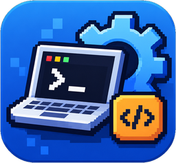
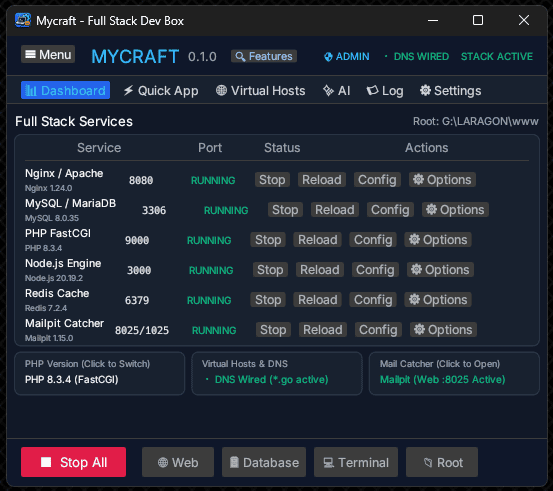
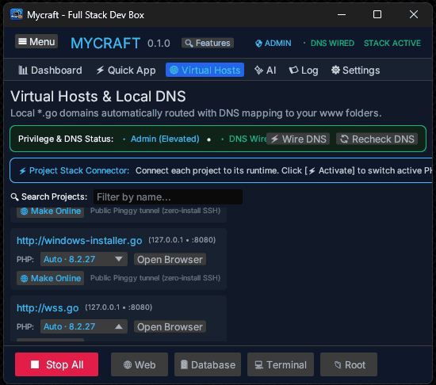
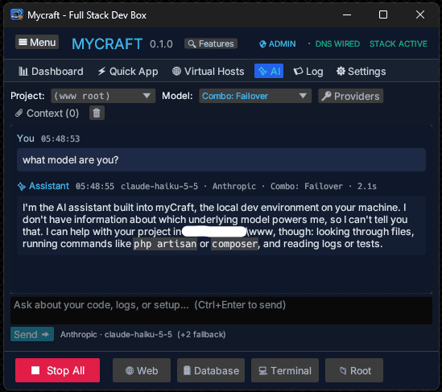

<p align="center">
  
</p>

<h1 align="center">myCraft</h1>

<p align="center">
  <b>A small, fast full-stack local dev box, inspired by <a href="https://github.com/leokhoa/laragon">Laragon</a>.</b><br>
  Web server, mail catcher, pretty URLs, Quick App and an AI assistant in one native app, written in Rust with <a href="https://github.com/emilk/egui">egui</a>.<br>
  Windows · macOS · Linux
</p>

<p align="center">
  <a href="https://github.com/dekate/myCraft/releases/latest"></a>
  <a href="https://github.com/dekate/myCraft/releases"></a>
  
  
  
  <br>
  <a href="https://ko-fi.com/dekate"></a>
  <a href="https://trakteer.id/dekate"></a>
</p>

<p align="center">
  
</p>

<p align="center">
  <a href="#features">Features</a> ·
  <a href="#ai-assistant">AI Assistant</a> ·
  <a href="#downloads">Downloads</a> ·
  <a href="#get-started">Get started</a> ·
  <a href="#project-layout">Project layout</a> ·
  <a href="#code-signing-policy">Code signing</a> ·
  <a href="#license-and-credits">License</a>
</p>

---

## Features

- One-click **Start All / Stop All** for the web, MySQL, PHP FastCGI, Node.js, Redis and Mailpit services
- Built-in **HTTP server** serving your `www` folder, with a project hub at `http://localhost:8080`
- **Pretty URLs** (default `http://<project>.go`, customizable to `.test`, `.local`, etc. in Settings) by wiring entries into the Windows hosts file

<p align="center">
  
  <br>
  <sub>Virtual Hosts: projects get custom local URLs (default <code>.go</code>), their own PHP version and a one-click public tunnel.</sub>
</p>

- **Quick App** scaffolding for common frameworks
- Built-in **mail catcher**: SMTP on port 1025, web inbox on port 8025
- Shortcuts to the terminal, database tools and the www folder; activity log and per-service config editor
- **AI Assistant** tab: chat about a project with its files attached as context, using your own API keys


## AI Assistant

<p align="center">
  
  <br>
  <sub>AI tab: each reply shows the model that answered, its provider, the routing mode and the time taken.</sub>
</p>

Open the **✨ AI** tab, then **🔑 Providers**:

1. Add one or more providers: Anthropic, OpenAI, Google Gemini, DeepSeek, OpenRouter, Groq, Ollama (local), or any OpenAI-compatible endpoint. Several keys for the same vendor are fine.
2. Paste each key and press **⟳ Test / models** to check it and load the model list.
3. Add **routes** (provider + model), mark each one `small` or `big`, and order them by priority.
4. Pick a routing mode:
   - **Failover**: try routes top to bottom; on any error or rate limit, move to the next.
   - **Round robin**: start from a different route each message to spread load across keys; still fails over.
   - **Auto size**: short, simple prompts go to `small` routes; long prompts, code, large attached files or complex tasks (refactor, debug, implement…) go to `big` routes. The other tier is the fallback.
   - **Single model**: choose one route from the Model dropdown, no fallback.

A route that answers 429/529 is moved to the back of the queue for 60 seconds. Each reply shows which model answered, the tier, the time taken and whether a failover happened.

**Project awareness.** The assistant works on the project picked in the chat bar:

- **Auto project context** sends a two-level file tree plus key manifests (README, `composer.json`, `package.json`, `Cargo.toml`, `.env.example`…) with each message. `.env` is never read.
- **Let AI run commands** gives the model a `run_command` tool: it runs `cmd.exe` commands in the project folder and reads the output (2-minute timeout, no input). By default you approve each command (▶ Run / ✖ Skip / Always allow); tick **without asking** in 📎 Context to skip approval. Commands run with your Windows account's permissions.

Settings live in `%APPDATA%\myCraft\ai.json`. On Windows, API keys are encrypted with DPAPI, so only your Windows account can read them. Attached files (up to 200 KB each) are sent to the provider you route to.

## Downloads

The [latest release](https://github.com/dekate/myCraft/releases/latest) has every build listed below, and [all releases](https://github.com/dekate/myCraft/releases) has earlier versions and their notes. `<ver>` in the file names is the version number, and `SHA256SUMS.txt` lists a checksum for every file.

### Windows

| Build | File |
|---|---|
| x64 (64-bit Intel/AMD) | `mycraft-<ver>-windows-x64.exe` |
| arm64 (Snapdragon and other ARM PCs) | `mycraft-<ver>-windows-arm64.exe` |

A single portable exe: put it in the folder you want as your myCraft root (for example `C:\myCraft`) and run it. It creates `www\`, `bin\`, `conf\` and `etc\` next to itself. Windows 10 or 11.

Windows builds are being set up for code signing through the SignPath Foundation (see [Code signing policy](#code-signing-policy)). Until a release is signed, SmartScreen may warn on first launch: choose **More info → Run anyway**. To check a download, compare `Get-FileHash <file> -Algorithm SHA256` with `SHA256SUMS.txt`.

### macOS

| Build | File | Notes |
|---|---|---|
| App, universal (Apple silicon + Intel) | `mycraft-<ver>-macos-universal.zip` | macOS 11 or later; not notarized |

Unzip and move `myCraft.app` to Applications. It isn't notarized, so the first time, right-click it and choose **Open**, or run `xattr -dr com.apple.quarantine /Applications/myCraft.app`.

### Linux

| Format | x86_64 | aarch64 (ARM64) |
|---|---|---|
| Tarball | `mycraft-<ver>-linux-x86_64.tar.gz` | `mycraft-<ver>-linux-aarch64.tar.gz` |

Unpack anywhere and run `./mycraft`. Needs glibc 2.35 or newer (Ubuntu 22.04+, Debian 12+, Fedora 36+) and an X11 or Wayland desktop.

> [!NOTE]
> myCraft is built around Windows and a Laragon-style folder layout. The macOS and Linux builds are **experimental**: the UI, web server, project hub, mail catcher, tunnels and AI tab run, but hosts-file wiring, the tray icon, the Windows tool shortcuts and DPAPI key encryption are Windows-only. On macOS and Linux, AI API keys are stored **unencrypted** in `ai.json`.

## Get started

Building needs stable Rust.

```sh
git clone https://github.com/dekate/myCraft
cd myCraft/app
cargo run                    # debug build, with a console for logs
cargo build --release        # app/target/release/mycraft(.exe), no console window on Windows
cargo test                   # unit tests (AI routing, task classifier, key encryption)
```

On Linux, install the windowing headers first: `sudo apt-get install libxkbcommon-dev libxcb-render0-dev libxcb-shape0-dev libxcb-xfixes0-dev`.

myCraft looks for a Laragon-style layout at `G:\LARAGON` (`www\`, `bin\`, `etc\`) when run from `cargo`, and otherwise uses the folder the exe is in.

The Windows exe has `app/assets/logo.png` embedded as its icon. The UI fonts (Inter, Noto Sans Symbols 2) are compiled into the app too, so it needs no internet connection or installed fonts.

### Releasing

Bump `version` in `app/Cargo.toml` and push to `main`. The [Release workflow](.github/workflows/release.yml) tests and builds every platform above, then drafts the GitHub release `v<version>` with the files, `SHA256SUMS.txt` and notes listing every commit since the last release and any new contributors. Check the draft on GitHub and press **Publish release**. Pushing again before publishing rebuilds the draft; once published, the version must be bumped again.

## Project layout

```text
app/
  src/main.rs     entry point, window setup, starts the background servers
  src/state.rs    app state and actions (services, vhosts, Quick App, logs)
  src/server.rs   HTTP server, project hub, DB page, mail catcher (std::net only)
  src/tunnel.rs   public tunnels and the per-project request handler
  src/app.rs      the egui UI
  src/ai.rs       AI chat engine: providers, keys, routing, API calls
  src/ai_tab.rs   AI tab and Providers & Routing window
  src/tray.rs     Windows system-tray icon and menu
  build.rs        embeds the Windows exe icon
  assets/logo.png
  assets/fonts/   Inter and Noto Sans Symbols 2, embedded in the app
  vendor/         patched egui_commonmark_backend (real bold in AI replies)
.github/
  workflows/release.yml       builds all platforms and drafts the release
  scripts/release-notes.sh    commit list and new contributors for the notes
docs/             README screenshots
```

## Code signing policy

Free code signing provided by [SignPath.io](https://about.signpath.io), certificate by [SignPath Foundation](https://signpath.org).

Only the Windows `.exe` files attached to [GitHub releases](https://github.com/dekate/myCraft/releases) are signed. They are built from this repository's source by the [Release workflow](.github/workflows/release.yml) on GitHub-hosted runners; nothing built elsewhere is signed.

Team roles:

- Committers and reviewers: [dekate](https://github.com/dekate)
- Approvers: [dekate](https://github.com/dekate)

Every signing request is approved manually by an approver.

### Privacy

This program will not transfer any information to other networked systems unless specifically requested by the user or the person installing or operating it. myCraft connects to the internet only when you ask it to: installing or updating packages (PHP, Node.js, MariaDB, Composer, HeidiSQL, Redis) from their official sources, creating Quick App projects, opening a public tunnel for a project, or sending AI chat messages to the providers you add with your own API keys. Those services' own privacy policies apply to what you send them.

## License and credits

[MIT](LICENSE). myCraft is an independent project and is not affiliated with Laragon.

Bundled fonts are under the SIL Open Font License 1.1: Inter ([license](app/assets/fonts/Inter-OFL.txt)) and Noto Sans Symbols 2 ([license](app/assets/fonts/NotoSansSymbols2-OFL.txt)). The vendored `egui_commonmark_backend` is MIT OR Apache-2.0.
